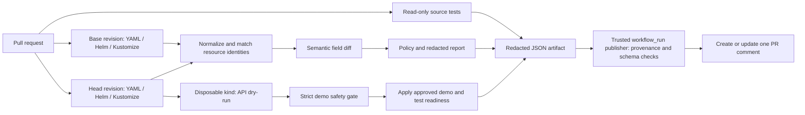

# Kubernetes PR Impact Analyzer

Review the **rendered Kubernetes configuration a pull request would change**, with actionable risk findings and real kind validation. Built in Go; no AI service, database, or GitHub credentials required for local use.

[Live demo PR](https://github.com/charalamposlamprou/kube-pr-impact-analyzer/pull/9) · [Automatically updated bot report](https://github.com/charalamposlamprou/kube-pr-impact-analyzer/pull/9#issuecomment-7059066918)

The core engine compares Kubernetes objects, **not Git hunks or YAML text**. It independently renders both revisions, identifies resources by `(API group, Kind, Namespace, Name)`, normalizes quantities and known unordered fields, and reports additions, deletions and meaningful changes. A Helm values change is analyzed through the Deployment produced by Helm.

## What you get

- Plain YAML/JSON, Helm and Kustomize rendering, multi-document YAML and Kubernetes Lists.
- Container-aware field comparisons, exact CPU/memory quantity normalization, deterministic output and safe percentage calculations.
- Change-based operational and security rules, configurable severities and CI failure thresholds.
- Markdown summaries with expandable resource details, plus versioned JSON reports.
- A single updated `github-actions[bot]` PR comment with validation results and a verified Actions run link.
- Real Kubernetes API dry-run, isolated demo application, rollout and HTTP integration tests in disposable kind clusters.
- MIT license, Docker packaging, GHCR release workflow, race tests, `go vet`, Staticcheck and Actionlint.



## Requirements and installation

- Go **1.26.0+** (the pinned go-github v93 client requires Go 1.26).
- Helm **4.1.1**, Kustomize **5.8.1** when rendering those formats.
- For integration: Docker, kind **0.31.0**, kubectl **1.35.0**, Bash and Python 3.
- CI runs on Ubuntu 24.04, using the digest-pinned Kubernetes 1.35.0 kind node image. Allocate roughly 4 CPUs and 6 GiB RAM to Docker for the demo.

```bash
git clone https://github.com/charalamposlamprou/kube-pr-impact-analyzer.git
cd kube-pr-impact-analyzer
make build
bin/kube-impact version
```

Linux tool installation is available with `make tools`; add `$HOME/.local/bin` to `PATH`. On macOS install Docker, kind, kubectl, Helm and Kustomize with your package manager. Go automatically downloads a compatible toolchain when enabled. Dependencies are pinned in `go.mod` and `go.sum`.

## Local CLI

```bash
# Unchanged baseline: zero semantic changes.
bin/kube-impact diff --base examples/base --head examples/head

# Customized CPU/memory report, without GitHub credentials.
bin/kube-impact diff --base examples/base \
  --head examples/scenarios/a-resources --format markdown

# Apply the policy; high findings return exit code 3 after writing the report.
bin/kube-impact analyze --base examples/base \
  --head examples/scenarios/c-security --policy config/policy.yaml \
  --format json --output artifacts/security.json

bin/kube-impact validate --manifests examples/head
bin/kube-impact report --base examples/base \
  --head examples/scenarios/a-resources --output artifacts/report.md

# The paths can point at different git worktrees/revisions.
bin/kube-impact diff --base /tmp/base-chart --head /tmp/head-chart --mode helm
bin/kube-impact diff --base /tmp/base-overlay --head /tmp/head-overlay --mode kustomize

# API access is opt-in and requires an explicit kubeconfig context.
bin/kube-impact validate --manifests examples/head \
  --server --context kind-my-test-cluster

# Rendered output can contain secrets. A private output file is mandatory.
bin/kube-impact render --manifests examples/head --output /tmp/rendered.json
```

`diff` and `report` include findings but do not enforce the risk threshold. `analyze` enforces it. All report-producing commands support `--format markdown|json` and `--output`. `report --input report.json --checks kind-checks.json` combines an existing report and integration checks. Render and API operations have a configurable `--timeout` (default two minutes).

| Exit code | Meaning |
|---|---|
| 0 | Requested checks passed, or informational report completed |
| 1 | Usage, rendering, I/O, tool or internal failure |
| 2 | Static/API validation or demo safety-gate failure |
| 3 | Configured risk threshold violated (`analyze`) |

Validation failures take precedence over policy failures. A report is written before codes 2/3 when analysis completed. Rendering failures can prevent a report; CI creates a sanitized failure report in that case.

## Select render targets

CI reads `config/targets.yaml` **from the trusted base revision** and renders every configured target in both revisions. This catches changes to values, templates, patches and local dependencies without brittle file-extension filtering. Unrelated source changes produce an empty semantic diff. Fixtures are deliberately excluded.

```yaml
targets:
  - path: deploy/plain
    mode: yaml
    namespace: production
  - path: charts/payment
    mode: helm
    release: payment
    namespace: production
    values: [values-production.yaml]
  - path: deploy/overlays/production
    mode: kustomize
```

```bash
bin/kube-impact analyze --base /tmp/base --head /tmp/head \
  --targets config/targets.yaml --policy config/policy.yaml
```

`auto` detects a Chart or Kustomization at the target root, otherwise loads manifests recursively. Configure mixed repositories with explicit targets. Helm dependencies must be vendored; the tool does not run `helm dependency update`, plugins or post-renderers. Helm uses a fixed Kubernetes version and release name for repeatability. Avoid random/time-dependent template functions and remote Kustomize resources; vendor inputs for deterministic, offline rendering. Kustomize uses its root-only load restriction with exec plugins and Helm integration disabled.

A missing configured target represents an empty resource set in that revision, allowing entire directories to be added/deleted. Invalid YAML and duplicate identities fail. Filesystem symlinks and paths escaping the revision are rejected. Overlapping targets that render the same identity are rejected. To add targets or change policy in CI, merge that reviewed configuration before the manifest change; a PR cannot weaken its own analysis policy.

## Try the demo

The demo is a small Go HTTP server with a Deployment, ClusterIP Service, ConfigMap, HPA, requests/limits, three health probes and a restricted security context. Both approved image versions are built locally from source and loaded into kind. No external application image is pulled. HPA objects are validated, but metrics-server is intentionally absent: **autoscaling behavior is not tested**.

```bash
make demo                  # writes artifacts/report.md
make kind-test             # baseline, real cluster and cleanup
scripts/kind-test.sh examples/scenarios/a-resources artifacts/resources-kind
scripts/kind-test.sh examples/scenarios/e-safe-image artifacts/image-kind
```

The script creates a unique cluster and private kubeconfig, waits for nodes, builds scratch images, performs server dry-run, applies only approved demo resources, waits for the rollout, verifies live replicas/images/requests/limits, counts ready Service endpoints and probes HTTP via port-forward. It removes the cluster on exit. Failure artifacts contain pod/node summaries and event **reasons**, never raw manifests, container logs or environment values.

The gate rejects privileged containers, host namespaces, arbitrary images, host mounts, RBAC and other non-demo resources. Security/networking regression scenarios still receive a semantic report and API validation, but they are deliberately **not applied**. Skipped readiness is not presented as success.

| Scenario | Change | Expected findings |
|---|---|---|
| [A: resources](examples/scenarios/a-resources/demo.yaml) | Double requests and limits | Medium: CPU and memory requests +100%; possible capacity impact |
| [B: scaling](examples/scenarios/b-scaling/demo.yaml) | Replicas 3 → 1, HPA max 5 → 2 and target 70 → 60 | Medium: lower replica count and scaling ceiling |
| [C: security](examples/scenarios/c-security/demo.yaml) | Enable privileged mode and privilege escalation | High; policy fails; apply gate rejects |
| [D: networking](examples/scenarios/d-networking/demo.yaml) | ClusterIP → LoadBalancer | High: potential exposure/cost; apply gate rejects |
| [E: safe image](examples/scenarios/e-safe-image/demo.yaml) | Approved version 1.0.0 → 1.1.0 | Low: normal workload rollout; no high/medium finding |
| [F: multiple](examples/scenarios/f-multiple/demo.yaml) | Resources, scaling, image and Service | Consolidated report for three changed resources; high exposure finding |

Every scenario has automated assertions. `TestHelmValuesProduceRenderedDeploymentDiff` invokes the real Helm binary twice and proves that changing values from `250m` to `500m` produces a single Deployment CPU-request change of `+100.0%`. Real Kustomize patch rendering is tested too. Set `REQUIRE_RENDER_TOOLS=1` to fail rather than skip those tests when tools are absent.

## GitHub Actions setup and beginner walkthrough

1. Fork this repository (or publish it to a new GitHub repository) with the workflows on the default branch. Enable GitHub Actions. No personal access token or repository secret is needed.
2. Keep the workflow's explicit permissions. The analysis workflow only reads repository contents. Only the publisher receives `pull-requests: write`; it checks out the default branch, never PR code. Your organization must allow this permission.
3. Create a branch and change the demo CPU/memory:

   ```bash
   git switch -c demo/increase-resources
   cp examples/scenarios/a-resources/demo.yaml examples/head/demo.yaml
   make demo
   git add examples/head/demo.yaml
   git commit -m "Increase payment-api resource requests and limits"
   git push -u origin demo/increase-resources
   gh pr create --title "Demo: increase payment-api resources" \
     --body "Exercise rendered semantic diff and kind validation."
   ```

4. Open the PR's **Actions/Checks** tab. `quality` tests the proposed source in a separate read-only job. `impact` builds the trusted base analyzer, independently renders base and head, evaluates policy and runs kind.
5. After analysis finishes, `Publish Kubernetes report` reads the bounded JSON artifact through the API, verifies run/PR/head association, and creates the bot comment. Open its expandable Deployment section.
6. Change `500m` to `750m`, commit and push. The same marked comment is updated. Stale runs are ignored if the PR head has moved. You do not need to close/reopen the PR.
7. Copy scenario C into `examples/head/demo.yaml` to see a high-risk policy failure and a rejected demo application. Review the separate API-validation and readiness results.

First-time fork contributors may require a maintainer to approve the read-only workflow run in GitHub. Never move analysis into `pull_request_target` or expose secrets to the PR job. The publisher workflow must already exist on the default branch. Configure required checks in branch protection if these outcomes should block merging; the comment itself is informational.

## Example PR comment

### Kubernetes Change Impact Report

**0 added · 1 modified · 0 deleted** · **Risk level: medium**

**Resource:** Deployment / impact-demo / payment-api

| Configuration | Before | After | Change |
|---|---|---|---|
| CPU Request · api | 250m | 500m | +100.0% |
| CPU Limit · api | 1000m | 2000m | +100.0% |
| Memory Request · api | 256Mi | 512Mi | +100.0% |
| Memory Limit · api | 512Mi | 1Gi | +100.0% |

**Operational impact:** Resource reservations increased by 100%. Scheduling could be affected by available node capacity. Check quotas, allocatable capacity and rollout surge requirements. This change alone does not establish a scheduling failure or outage.

The actual comment includes per-check results, expandable sections, safe before/after values, recommendations, an invisible `<!-- kube-impact:report:v1 -->` marker and a verified Actions run link. Large reports keep a bounded comment and direct readers to the JSON artifact.

## Risk policy

See [config/policy.yaml](config/policy.yaml) and the complete [policy reference](docs/policy.md). Unknown rule names and invalid severities fail closed.

```yaml
failOn: high                    # none | low | medium | high
significantRequestIncreasePercent: 50
requireLimits: true             # flag removal of existing limits
rules:
  privileged:
    enabled: true
    severity: high
  requests-increased:
    severity: medium
  configuration-changed:
    enabled: true
    severity: low
```

Rules evaluate changes, not a full security audit of pre-existing configuration. Removing a readiness-probe option is not mistaken for removing the entire probe. Removing a container does not report that deleted container as losing limits or switching to `latest`. Missing and zero request baselines do not produce percentages.

## Supported resources and semantics

| Resources | Compared fields and interpretation |
|---|---|
| Deployment, StatefulSet, DaemonSet | Replicas, keyed containers/init containers, images, resources, env names/references, probes, ports, service account, security contexts, host settings, volumes and mounts |
| Service, Ingress | Types, selectors, ports, hosts, paths, backends and TLS references |
| ConfigMap, Secret | Key/value changes detected internally; values redacted in all reports |
| HPA, PDB | Bounds, metrics/targets, selectors and disruption settings |
| ServiceAccount, Role, ClusterRole, RoleBinding, ClusterRoleBinding | Account options, rules, subjects, role references and wildcard changes |
| NetworkPolicy | Selectors, policy types, ingress/egress peers and ports; deletion risk |
| PVC | Storage requests, access modes, storage class and volume binding fields |
| Unknown kinds and CRDs | Generic recursive structural diff; cluster scope inferred from included CRDs |

Resource API **version** changes are fields on the same group/kind identity. Namespace omission normalizes to the target namespace (`default` unless configured); built-in cluster-scoped resources have no namespace. Status and server-assigned metadata are ignored. Known set-like RBAC and policy lists are normalized, including equivalent split permission rules. Init-container order and environment declaration order used by variable expansion remain significant; ordered command/argument and unknown CRD lists stay ordered. CPU uses millicores; equivalent binary/decimal memory quantities compare equally.

## Development and packaging

```bash
make check             # build, race tests, vet, Staticcheck, Actionlint
make kind-test         # requires Docker and cluster tools
make kind-failure-tests # prove API rejection and safety-gate rejection are distinct
make demo

docker build -t kube-impact:local .
docker run --rm -v "$PWD/examples:/data:ro" kube-impact:local \
  diff --base /data/base --head /data/scenarios/a-resources
```

The compact non-root image supports plain-manifest analysis. Helm, Kustomize and kubectl are optional host tools; extend the image with pinned binaries if you need those commands inside the container. Tagging `v*` runs the GHCR release workflow; it publishes `ghcr.io/<owner>/<repository>:<tag>` using only `GITHUB_TOKEN`. No package is published merely by building locally.

## Security and limitations

Read [SECURITY.md](SECURITY.md) and [architecture/security boundaries](docs/architecture.md).

- Secret payloads, literal environment values, ConfigMap data, annotations, command arguments and HTTP header values are redacted before serialization. Reference names remain useful where safe. Arbitrary secrets hidden in resource names or unrecognized CRD fields cannot be reliably inferred; do not put credentials there.
- Renderer stderr and Kubernetes error details can echo values, so they are suppressed. `render` intentionally writes **unredacted** manifests to a mode-0600 file. Do not upload those files.
- Static validation uses strict built-in Go types and selected invariants, not the complete OpenAPI/admission rule set. Unknown API versions and CRDs receive generic local checks; API dry-run requires installed APIs/CRDs, namespaces and admission services.
- kind validates its own Kubernetes API and the isolated demo. It cannot establish production capacity, cloud load-balancer behavior, NetworkPolicy enforcement, production security-policy acceptance or availability. NetworkPolicy semantics depend on a supporting CNI.
- No resource is deployed to a production cluster. CLI `validate --server` is dry-run only. The kind harness applies just the allowlisted demo.
- Helm randomness, time functions, remote dependencies and environment-dependent generators can make renders non-reproducible. Vendor inputs, avoid those functions and use deterministic values. Rendering is not a sandbox for hostile template engines: use disposable runners without credentials.
- A fresh kind cluster has no production resource history; dry-run cannot establish that an update satisfies immutability constraints against existing production objects.
- Defaulting and admission mutation are not simulated in the semantic diff. An omitted field and explicit API default can appear different. Unknown custom resources default to namespaced unless a matching cluster-scoped CRD is included.
- RBAC findings identify changed wildcard permissions, not a complete authorization graph. Runtime risks are qualified possibilities; no AI-generated predictions are used.
- Report data is generated in a read-only PR job and is informational. Its structure, origin and association are checked, but a contributor who changes the workflow can fabricate its content. The publisher never treats it as executable code or a security authorization.

## Troubleshooting

| Symptom | What to check |
|---|---|
| Render failed | Use the same pinned tools; run `helm template`/`kustomize build` locally with non-sensitive test data, check vendored dependencies and target paths |
| Duplicate identity | Remove overlapping targets or duplicate group/kind/namespace/name objects |
| API dry-run failed | Check namespace existence, supported API versions, CRDs and admission constraints; do not paste secret-bearing kubectl errors into public comments |
| Demo apply rejected | Restore the approved image, namespace and restricted security settings; this gate intentionally excludes arbitrary resources |
| Rollout timed out | Check Docker resources, pod scheduling and image names; demo images use `imagePullPolicy: Never` and must be loaded into kind |
| No bot comment | Check publisher is on default branch, Actions is enabled, fork approval and `pull-requests: write` are allowed, and inspect publisher run status |
| Older report remains | A newer commit invalidates an older run; wait for analysis of the current head |
| HPA has missing metrics | Expected in the minimal demo; metrics-server and load tests are outside its claims |

See [CONTRIBUTING.md](CONTRIBUTING.md) for development conventions and [docs/verification.md](docs/verification.md) for recorded verification evidence.
